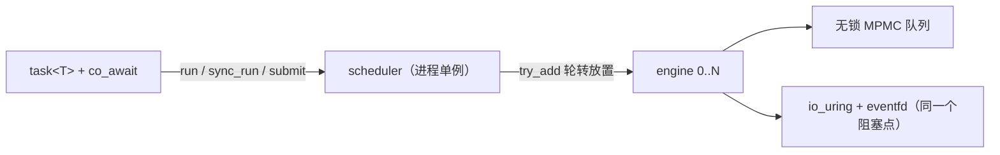

# llco

一个高性能、轻量级的 C++23 协程编排运行时。

## 用例

```cpp
constexpr int JOBS = 8;

task<> job(latch *done) {
    std::this_thread::sleep_for(20ms);  // stand-in for real work
    done->count_down();
}

task<> fan_out(latch *done) {
    for (int i = 0; i < JOBS; ++i)
        run(job(done));                 // each child lands on the next engine
    co_await done->wait();              // when_all, in one line
}

int main() {
    scheduler::init(4);
    latch all{JOBS};
    sync_run(fan_out(&all));            // 8 x 20 ms on 4 engines: ~41 ms, not 160 ms
}
```

将任务作为协程函数就可以如示例代码般编排运行。完整可跑的版本是 [examples/fanout.cpp](examples/fanout.cpp)，其余场景见 [examples/README.md](examples/README.md)。

## 快速开始

需要 Linux（io_uring）、CMake ≥ 3.25、Ninja、liburing；编译器用 clang 22 + libc++ 或 GCC 14。

```bash
cmake --preset default
cmake --build --preset default
ctest --preset default
```

五套构建都在 [CMakePresets.json](CMakePresets.json) 里：`default`（clang + libc++）、`asan`（ASan + UBSan）、`tsan`（ThreadSanitizer）、`trace`（打开 trace）、`gcc`（G++ 14）。示例、测试与 bench 统一输出到 `build/bin`。

```bash
./build/bin/echo_server     # 监听 127.0.0.1:7000，可以 nc 连接上去测试
scripts/trace.sh fanout     # 生成 trace.json，可借助 ui.perfetto.dev 可视化
```

## 架构



各层级间单向依赖。分层理由与每处取舍见 [docs/architecture.md](docs/architecture.md)。

## 文档

- [docs/README.md](docs/README.md) —— 全部文档的索引
- 三篇最能说明取舍的 ADR：[0003 eventfd 作为唯一阻塞点](docs/adr/0003-eventfd-blocking-point.md)、[0007 socket 只走 send/recv（SIGPIPE 实测）](docs/adr/0007-sockets-use-send-recv.md)、[0009 IO 错误是值不是异常](docs/adr/0009-io-errors-are-values.md)
- [docs/bench.md](docs/bench.md) —— 微基准、测量方法与如何读数字
- [GLOSSARY.md](GLOSSARY.md) —— 术语表

## 性能

运行时微基准（同机 A/B）：单次 `try_add`、跨线程唤醒、`spawn` + 完成、`sync_wait` 往返、`resume_on` 往返。方法见 [docs/bench.md](docs/bench.md)。

echo_server 对照组，裸机 Ryzen 5 PRO 6650U + NixOS 6.18，4 KB 消息、单连接 ping-pong，三次中位数：

| 实现               | 吞吐         | p50      | p99      | 服务端 CPU | 系统调用/消息 |
| ------------------ | ------------ | -------- | -------- | ---------- | ------------- |
| 手写 epoll（对照） | 46.0 k msg/s | 20.61 µs | 24.23 µs | 31.0%      | 3.00          |
| raw io_uring（对照，零框架） | 44.1 k msg/s | 21.60 µs | 25.43 µs | 40.6% | 5.00 |
| llco，1 engine     | 43.5 k msg/s | 21.66 µs | 26.96 µs | 41.1%      | 5.00          |

三层对照可得结论：**框架本身几乎 0 开销**（raw io_uring → llco 只差 0.06 µs、0.5 个百分点的 CPU，系统调用数完全相同）。单连接时开销大的是 **io_uring + eventfd 的每消息唤醒**（每消息 5 次系统调用 vs epoll 的 3 次）。

384 连接、六线程负载端、engine 各绑一核时：

| 实现                         | 吞吐          | p50     | p99     | 服务端 CPU |
| ---------------------------- | ------------- | ------- | ------- | ---------- |
| 手写 epoll（对照）           | 134.6 k msg/s | 2857 µs | 3003 µs | 63.7%      |
| raw io_uring（对照，零框架） | 147.5 k msg/s | 2599 µs | 2731 µs | 57.0%      |
| llco，1 engine               | 146.6 k msg/s | 1705 µs | 1751 µs | 58.0%      |
| llco，2 engines              | 290.6 k msg/s | 852 µs  | 884 µs  | 113.2%     |
| llco，3 engines              | 367.1 k msg/s | 977 µs  | 2000 µs | 182.9%     |

单连接时 io_uring 比 epoll 贵（每消息 5 次系统调用对 3 次），连接数上来后反过来：llco 每消息只付 0.031 次 `io_uring_enter`，一次提交带走约 32 条消息，而 epoll 每条消息固定 1 次 `recvfrom` + 1 次 `sendto`。所以这里 llco 比 epoll 快 8.9%、服务端 CPU 低 5.7 个百分点。

机器条件、归因与八条失真点见 [docs/bench.md](docs/bench.md)。

## 已知限制

- 没有取消与超时：`stop()` 要等 `running_io() == 0`，连接上待完成的 `recv` 必须先 `io::cancel` 才能退出。
- IPv4 only；`net::connection` 不设 `TCP_NODELAY`（示例与压测载体自己设）、没有连接数上限。
- 队列有界（8192）：满载时 `scheduler::submit` 返回 `false` 并销毁帧（[ADR-0004](docs/adr/0004-full-queue-policy.md)）。
- `scheduler` 是进程内单例，`init` / `stop` 不得与 `submit` 并发。
- engine 默认不绑核：`init(count)` 不传核表时线程由内核放置，`isolcpus` 机器上会挤在一个核（[ADR-0013](docs/adr/0013-engine-affinity.md)）。
- `trace::flush` 只能在没有其它线程产生事件时调用（典型：所有 engine 停止后）。
- 不做 work stealing、优先级队列、跨进程。

## License

MIT
