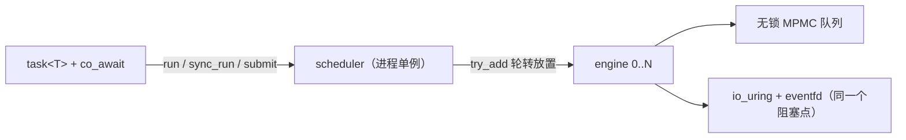

# llco

一个 C++23 协程编排运行时。`task` 管"怎么写"，`engine` 管"在哪条线程上跑"，`scheduler` 管"放到哪个 engine"。

**它不用在热路径上。** 一次协程恢复要过队列、过调度器，成本从几十纳秒到几十微秒；llco 面向的是 off-hot-path 的多任务编排——协议解析、任务分发、等待 IO，不是逐笔行情。这条边界和它背后的实测写在 [docs/architecture.md](docs/architecture.md) 与 [docs/adr/](docs/adr/) 里，是这个仓库最想说明的事情。

## 二十行看完

```cpp
constexpr int JOBS = 8;

task<> job(latch *done) {
    std::this_thread::sleep_for(20ms);  // stand-in for real work
    done->count_down();
}

task<> fan_out(latch *done) {
    for (int i = 0; i < JOBS; ++i)
        run(job(done));                 // each child lands on the next engine
    co_await done->wait();              // when_all, in one line
}

int main() {
    scheduler::init(4);
    latch all{JOBS};
    sync_run(fan_out(&all));            // 8 x 20 ms on 4 engines: ~41 ms, not 160 ms
}
```

子任务是普通协程，`latch` 就是 when_all，调用点看起来是同步的。完整可跑的版本是 [examples/fanout.cpp](examples/fanout.cpp)，其余场景见 [examples/README.md](examples/README.md)。

## 快速开始

需要 Linux（io_uring）、CMake ≥ 3.25、Ninja、liburing；编译器用 clang 22 + libc++ 或 GCC 14（`<print>` 需要后者）。

```bash
cmake --preset default
cmake --build --preset default
ctest --preset default
```

四套构建都在 [CMakePresets.json](CMakePresets.json) 里：`default`（clang + libc++）、`asan`（ASan + UBSan）、`trace`（打开 trace）、`gcc`（G++ 14）。示例、测试与 bench 统一输出到 `build/bin`。

```bash
./build/bin/echo_server     # 监听 127.0.0.1:7000，nc 上去回显
scripts/trace.sh fanout     # 生成 trace.json，拖进 ui.perfetto.dev
```

## 架构



三条单向依赖：`engine` 不认识 `scheduler`，`task` 不认识 `engine`，`io_uring` 不出 `engine`。分层理由与每处取舍见 [docs/architecture.md](docs/architecture.md)。

## 文档

- [docs/README.md](docs/README.md) —— 全部文档的索引
- 三篇最能说明取舍的 ADR：[0003 eventfd 作为唯一阻塞点](docs/adr/0003-eventfd-blocking-point.md)、[0007 socket 只走 send/recv（SIGPIPE 实测）](docs/adr/0007-sockets-use-send-recv.md)、[0009 IO 错误是值不是异常](docs/adr/0009-io-errors-are-values.md)
- [docs/bench.md](docs/bench.md) —— 微基准、测量方法与如何读数字
- [GLOSSARY.md](GLOSSARY.md) —— 术语表

## 性能

目前只有运行时微基准：单次 `try_add`、跨线程唤醒、`spawn` + 完成、`sync_wait` 往返、`resume_on` 往返。数据和方法见 [docs/bench.md](docs/bench.md)——那是 WSL2 上的相对基线，只用于同机 A/B，不是可引用的绝对数字。

网络吞吐与尾延迟的对照测试（同机手写 epoll echo 作对照组）在补测中，落地后把表贴在这里。

## 已知限制

- 没有取消与超时：`stop()` 要等 `running_io() == 0`，连接上待完成的 `recv` 必须先 `io::cancel` 才能退出。
- IPv4 only；没有 `TCP_NODELAY`、没有连接数上限。
- 队列有界（8192）：满载时 `scheduler::submit` 返回 `false` 并销毁帧（[ADR-0004](docs/adr/0004-full-queue-policy.md)）。
- `scheduler` 是进程内单例，`init` / `stop` 不得与 `submit` 并发。
- `trace::flush` 只能在没有其它线程产生事件时调用（典型：所有 engine 停止后）。
- 不做 work stealing、优先级队列、跨进程。

## License

MIT
