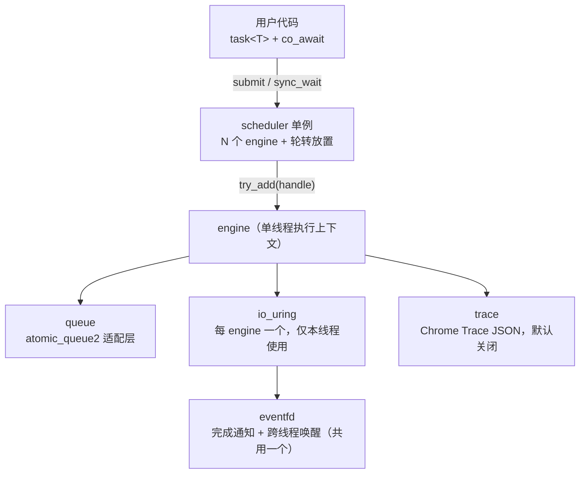

# llco 架构

## 一句话

llco 是一个 C++23 协程编排框架：**task** 负责"怎么写"，**engine** 负责"在哪条线程上按什么顺序跑"，**scheduler** 负责"该放到哪个 engine"。三者之间只通过协程句柄和队列耦合。

## 目标与边界

**目标**

- **易懂**：每一层都能单独读懂，engine 的核心循环不超过一屏，每个模块只有一个职责。
- **易用**：写业务的人只写 `task<T>` 和 `co_await`，不需要知道队列、线程、唤醒的存在。
- **高性能**：默认路径不加锁、不进内核；唤醒只花一次 `eventfd` 写；队列是无锁 MPMC。
- **可替换**：队列、IO 后端都能换实现，且换实现不触碰上层；放置规则暂时硬编码在 scheduler 里（ADR-0005）。

**非目标（明确不做）**

- 不用在热路径上：协程不是低延迟路径的方案，llco 面向 off-hot-path 的任务编排。
- 不追求 P2300 / `std::execution` 兼容：本机 libc++ 尚未实现 senders/receivers，调度层手写。
- 不做抢占式调度、不做跨进程、不做并行算法的包装。

## 分层与依赖方向



**依赖方向是单向的**，这条规则决定模块怎么切：

- `engine` 认识 queue、io_uring、trace 和 `task`（只为 `spawn`），**不认识** scheduler。
- `scheduler` 认识 engine，**不认识** task 的内部。
- `sync`（event / latch）认识 engine：挂起时记下 `current_engine()`，唤醒时 `try_add` 回那个 engine；不认识 scheduler。
- `task` 不认识 engine；唯一需要 engine 的地方是 `co_await resume_on(e)`，它只依赖一个最小概念（见下），不依赖 engine 类型。
- `io_uring` 只在 engine 内部使用，不泄漏到 task 层。

## 关键概念

- **`Executor` 概念**：`resume_on` 唯一依赖的东西；engine、manual engine 都满足它。要求返回值**恰好**是 `bool`，不接受可隐式转换的 `int`：

```cpp
template <class E>
concept Executor = requires(E& e, std::coroutine_handle<> h) {
    { e.try_add(h) } -> std::same_as<bool>;
};
```

概念名用 CamelCase（`.clang-tidy` 的 `ConceptCase`），刻意和 lower_case 的具体类区分开。
- **handle 是唯一的交换单位**：队列里只放 `std::coroutine_handle<>`（8 字节、可平凡拷贝）。awaiter 不放队列——它活在协程帧里，寿命与队列不一致。
- **父协程**：一个协程结束后把控制权交回去的那个协程，也就是 `co_await` 它的那个协程。顶层任务没有父协程，控制权交回 `noop_coroutine`。
- **`sync_wait` 是调用线程的阻塞点**：`promise_base` 存一个 `std::binary_semaphore *`，`final_awaiter::await_suspend` 里**先** `release()` 再处理 continuation / detached（否则帧可能先被销毁）；`sync_wait` 在调用线程上 `resume()` 启动 root，然后阻塞在 semaphore 上，所以任务中途 `resume_on` 到别的 engine 也能被正确唤醒。这与 engine 自己的 eventfd 阻塞点无关。
- **scheduler 是进程内单例**（ADR-0010，推翻 ADR-0002）：`scheduler::init(n)` 建（或重建）N 个 engine，`stop()` 让每个 engine 排空已入队任务后退出，析构即 `stop()`。放置只有一个规则：`m_next.fetch_add(1) % n` 挑起点，满了就沿环交给下一个还有空位的 engine，整圈都满才销毁帧并返回 false（ADR-0004 / ADR-0005）。`engine_at(i)` 是测试与 demo 的入口。
- **trace 是环境级的**：`llco::trace` 是命名空间而非对象（不做单例）；`trace::scope` 构造发 `B`、析构发 `E`，RAII 保证配对；每线程一条线程轨道（`thread_local` 缓冲 + 全局注册表，线程退出时搬进 `finished`），`trace::flush(path)` 写出 Chromium JSON 并排空。引擎埋点受 `LLCO_TRACE` 编译期开关控制，默认 0 时 `run_once()` 一行都不多。

## 一次任务的生命周期

1. 用户写 `task<T>`（惰性，未开始）。`main` 通过 `scheduler::submit(std::move(t))` 或 `engine.spawn(std::move(t))` 交出所有权；或者在自己的协程里 `co_await` 一个子任务。
2. 提交：`task::release()` 交出句柄 → 句柄进目标 engine 的队列 → 写 eventfd 唤醒 → 返回。
3. engine 线程取出句柄 → `resume()` → 协程跑到第一个真正的挂起点。
4. 协程里 `co_await` 子任务：**inline symmetric transfer**，同一个线程直接跑子协程，不入队（ADR-0001）。
5. 需要换 engine / 换线程时：`co_await resume_on(other_engine)` → 自己的句柄入队（队列满则内联继续，ADR-0004）。
6. 协程结束：final awaiter 把控制权交回**父协程**；如果是 detached 任务，则就地自毁。
7. `sync_wait(t)` 的调用线程（很可能是 `main`）用 `std::binary_semaphore` 阻塞到任务结束，再把值或异常取走。**注意**：这是调用线程的阻塞点，与 engine 的 blocking point 无关，两者不共用原语。

## 五条关键机制

### 1. 父协程在哪条线程上继续：默认 inline

`co_await` 子任务时不经过队列（ADR-0001）。代价是一条链会占用栈深度、且不会主动换线程；收益是默认路径没有任何队列往返。需要公平性或防线长栈时补 `yield_on(engine)`，而不是改默认行为。

### 2. 阻塞点：每 engine 一个 ring + 一个共享 eventfd

M5 阶段还没有 ring：`start()` 只建一个 eventfd，循环只阻塞在 `read(eventfd)` 上，`try_add` / `spawn` 成功后写这个 fd 把线程唤醒。M6 起每个 engine 建一个 io_uring 实例（只建一次、跨 `start`/`stop` 复用、只由本线程使用），用**普通** `io_uring_register_eventfd` 把该 engine 的 eventfd 绑进 ring，于是**完成通知和唤醒共用一个阻塞点**，不需要 epoll（ADR-0003）。唤醒之后依次执行 `drain() → submit() → reap()`：排空任务队列、把这一轮 arm 出的 SQE 一次交给内核、再排空 CQ ring；阻塞条件是"任务队列空、CQ 空、且 SQ 里没有未提交项"（`io_uring_sq_ready()`——此时阻塞就会让 op 滞留未提交）。一个 ring 只接受一个注册，所以 `stop()` 先 unregister 再 close fd。IO 的提交、完成与关停各只有一条路径（ADR-0006）。

**只在 loop 真正阻塞时才写 eventfd**（M7）：`notify()` 里 `if (!m_idle.exchange(false)) return;`，loop 里先 `m_idle = true`、再看一眼队列与 CQ（只读，不运行任务），两处都空才 `read`——置位必须在复查之前，写反就是漏唤醒（窗口只有几条指令，压力测试未必复现）。`stop_requested()` 因此也要在置位之后再查一次，否则停机回调可能正好落在"查 stop"与"置位"之间而不发唤醒。内核 completion 直接写 fd、不经过这个标志，所以被内核完成通知唤醒后标志短暂仍是 true，此时到达的 push 会多发一次唤醒：多一次系统调用，无害。

### 3. 满载与背压

队列有界。外部路径返回 false（scheduler 用 `try_adopt` 拿同一个句柄换 engine 重试）；`spawn` 转移所有权后无路可退，满载即销毁帧并返回 false，所以返回值必须检查；协程内部的 `resume_on` 无处返回失败，约定"`try_push` 失败则由当前线程内联继续"（ADR-0004）。不阻塞、不静默丢弃、不引入无界后备。

### 4. 所有权与异常

- `task` 拥有帧，析构即 `destroy()`；`release()` 显式交出句柄。
- `spawn` 之后所有权归 engine：帧在 `final_suspend` 处自毁（promise 的 detached 位）；engine 必须比它 spawn 出去的任务存活更久，manual engine 销毁前先排空队列。
- 未捕获异常存在 promise 里，由 `co_await` 处 rethrow；detached 任务的异常交给 engine 的 exception handler，默认 `std::terminate`（宁可终止，不要静默）。

### 5. 关停顺序

`request_stop()` → stop_callback 写 eventfd 唤醒 → 线程被唤醒 → 排空队列 → **等到 `running_io() == 0`** → 退出循环 → `join()` → **调用线程再 `drain()` 一次** → unregister eventfd → close fd。两处等待各有理由：

- 循环自己的退出条件里带 `running_io() == 0`：**内核把 op 记在提交它的线程上**，提交线程一退出，还没完成的 op 就会以 `-ECANCELED` 回来（实测 `res=-125`；由仍然存活的线程提交则正常 `res=1`）。所以关停期间的排空必须在循环线程上完成，不能留给 join 之后的调用线程。
- 最后那次 drain 仍不是冗余：循环可能在 stop 之前就越过了 drain，而之后又有 push 入队，只有停止方自己再排空一次才能保证"stop 返回时已入队的任务都跑过"；这些任务若 arm 了新 op，由调用线程提交并等回来，调用线程存活到最后。

析构 = `stop()`，所以 `~engine` 里不会再执行任务（那时异常处理函数指针已经指向正在析构的对象）。代价：优雅停机对自我续期的任务无界（被恢复的任务再 arm 新 op，`running_io` 不归零），强制切断要等取消机制。

## scheduler：轮转放置与满载重试

- `scheduler::submit(task<T>&&)`：`release()` → 从游标起点沿环扫一圈 `try_adopt` → 有 engine 接受就返回 true；整圈都满、或 scheduler 已经 `stop()`，则 `destroy()` 帧并返回 false。放置只给起点，能不能落地由 `try_adopt` 决定（ADR-0005）。
- `scheduler::run(tasks...)` 是便利入口：任意多个 `task<T>` 一次提交，第一个装不下就抛 `std::runtime_error`（已接受的任务继续跑；被拒的帧按 ADR-0004 销毁，不回滚）。
- 单例与重建：`init(n)` 每次都换一套 engine（同 n 也重建），这是测试之间的归零点；`stop()` 保留 engine 对象，所以 `loop_count()` / `running_io()` 在关停后仍可读（ADR-0010）。
- 满载重试**不用** `spawn`：`spawn` 失败即销毁帧，任务会丢失；`try_adopt` 失败时所有权仍在调用方，同一个句柄可以继续试下一个 engine（ADR-0004 已按此订正）。
- `engine::load()` 是队列长度采样，只给测试与 demo 看积压，不参与放置。
- 跨 engine 继续执行仍走 M3 的 `resume_on`：目标 engine 只是另一个满足 `Executor` 的对象。trace 里每个 engine 线程把自己的线程轨道命名为 `engine-i`，继续执行表现为同一条 `resume` 切片出现在另一条线程轨道上；不做 flow 箭头，因为 `resume_on` 的 `await_suspend` 只拿到类型擦除的句柄，够不到 promise（见 `docs/ig_/M8`）。
- 线程轨道命名整段包在 `#if LLCO_TRACE` 里：默认构建没有 `m_lane` 成员、没有 `set_lane`、循环里也没有那一行。

## 同步原语与组合写法

- **`event<T>` 是唯一的基元**：一次性、广播。`set` 之前 `wait` 挂起；`set` 之后所有等待者恢复，各自拿到一份值的拷贝。等待者是侵入式 `next` 栈上的节点，活在协程帧里，不额外分配。
- **`latch` = 计数 + `event<void>`**：`count_down()` 归零时 `set()` 一次。
- **唤醒后的恢复位置**：awaiter 在挂起时记下 `current_engine()`；`set()` 一律 `try_add` 回那个 engine（同 engine 也不内联，`set` 的栈上不跑用户代码），没有归属的协程（`sync_wait` 的 root、manual engine）才内联恢复。因此同步原语跨 engine 安全，代价是一次队列往返；队列满时按 ADR-0004 回退内联。
- **`when_all` / `when_any` 不是组件，是组合写法**：

```cpp
// when_all：latch 计数
latch done{n};
for (std::size_t i = 0; i < n; ++i)
    scheduler::submit(work(i, &out[i], &done));   // 子任务最后一行 done.count_down()
co_await done.wait();

// when_any：event 必须共享，未完成任务还会引用它
auto first = std::make_shared<event<int>>();
for (std::size_t i = 0; i < n; ++i)
    scheduler::submit(probe(i, first));           // 子任务结束前 first->set(i)
const int winner = co_await first->wait();
```

不做组合器的理由：`when_all` 只是 latch 的三行样板，factory 形态还会限制"子任务由别人提交"的场景；`when_any` 的难点是共享状态寿命，做成组件反而掩盖了"剩余任务还在跑"的事实。等以后有取消机制，`when_any` 才有"取消未完成任务"的实质工作，那时再考虑组件化。

## 网络层（M12）

一条连接 = 一个 detached 协程：`accept` 拿到 fd → `recv`/`send` 循环 → 读回 0（EOF）或异常 → `shutdown(SHUT_WR)` → `close`。`accept_loop` 自己也是协程，每接一个连接就 `spawn` 一个回显协程（队列满载按 ADR-0004 丢连接并关 fd）。调用点用的是两个轻量封装（`net::connection` / `net::listener`），`io::` 层仍然只认显式 `ring&`。

- **数据面只走 `send`/`recv`**：`IORING_OP_WRITE` 在 peer 已关闭时 `res=-32` 且**真的投递 SIGPIPE**（SIG_DFL 下杀进程），`IORING_OP_SEND` 不会；`io::send` 硬编码 `MSG_NOSIGNAL`，不赌内核版本。`read`/`write` 只给 pipe 与文件（ADR-0007）。
- **提交时机**：`accept`/`connect`/`cancel` 与读写共用同一条路径——awaiter 只填 SQE，循环统一 `submit`；`connect` 的 `sockaddr_in` 被内核在提交时拷走，所以地址只需活到协程挂起期间。
- **关停**：`stop()` 要等 `running_io() == 0`，而监听 fd 上的 pending accept 永远等不到——`io::cancel(ring, fd)` 把它打断成 `-ECANCELED`；cancel 自己返回 `0`，没有可取消的 op 时 `-ENOENT`（映射成 `false`，不是异常）。demo 的收尾是：信号 → `sync_wait` 一个先 `resume_on` 到 engine 的 cancel 任务 → `stop()` → `close(listener)`。
- **fd 契约**：listener 与 accepted fd 都是非阻塞 + close-on-exec；关掉之前该 fd 上不能有未完成 op。IPv4 only（`connect` 收 `sockaddr_in`）。
- **错误语义**：内核返回值可能是负数的稳态操作（read/write/recv/send/accept/connect/cancel）一律返回 `std::expected<T, std::error_code>`，不抛；只有启动期与不变量失败才抛，未捕获即终止（ADR-0009）。
- **两个轻量封装**：`net::connection{ring, fd}` / `net::listener{ring, port}` 只是把 `ring` 和 fd 收进对象——成员函数直接返回 awaiter（`conn.recv(buf)`、`conn.send(view)`），`listener.accept()` 的 `await_resume` 是 `expected<connection, error_code>`，`listener.cancel()` 就是收尾那一发取消。fd 由析构关闭，`connection` 可 move（源置 -1），所以"把连接 move 进 `spawn` 的帧、帧被销毁时关 fd"是自动的。

### M13：连接由 scheduler 放置

一个 listener 在 engine 0 上，acceptor 用 `listener.accept_fd()` 拿原始 fd，`scheduler::submit(serve(fd))` 轮转放置；`serve` 在目标 engine 上首次执行（`current_engine()->ring()`），此后绑定。不使用 `SO_REUSEPORT`（ADR-0008）。

代价与边界：acceptor 单线程且与 engine 0 共用线程；每条连接一次跨线程入队 + 唤醒；队列满按 ADR-0004 丢连接并关 fd。关停仍只 cancel listener，而仍打开的连接（idle recv）会让 `stop()` 等到它们结束。trace 里 accept 与 echo 分属两条线程轨道。

## 文件布局约定

`include/llco/` 按层分目录，纯 header-only（**没有 `src/`**，CMake 里 `llco` 是 INTERFACE 库）：

```
include/llco/
  llco.hpp                                # 聚合头文件：只列用户会直接写到的类型
  attr.hpp  config.hpp                    # 跨切面：每一层都 include，留在顶层
  concepts/ executor.hpp                  # 只放 concept
  core/     task.hpp  resume_on.hpp       # 模板，单文件
  runtime/  queue.*  engine.*  scheduler.*
  sync/     event.hpp  latch.hpp  sync_wait.hpp   # 基元 + 阻塞点；组合写法写在文档里
  trace/    trace.*
  io/       io_uring.*                    # ring + 五个 awaiter 同文件（互相依赖）
  net/      socket.*                      # socket 就绪帮手，不碰 io_uring
```

五条规则：

1. **拆分阈值**：非模板的具体类/自由函数，合并后超过 **50 行**或超过 **3 个方法**才拆成 `*.decl.hpp` + `*.impl.hpp`（方法数 = 公开成员函数 + 具名自由函数，awaiter 的 `await_*` 各算一个）。**模板（`task`、`resume_on`）与 `concepts/`、`attr`/`config` 永远单文件**——模板的实现必须留在头里，拆开只会在实例化时才暴露问题。已拆的模块不会因为以后变小而自动合并：阈值只在新增模块或大改时判一次。
2. **入口只有一个**：拆开的模块由 `*.decl.hpp` 末尾 `#include <llco/.../同模块.impl.hpp>` 收口；`*.impl.hpp` 顶部反过来 include `.decl.hpp`（`#pragma once` 兜住循环）。用户永远只 include `.decl.hpp`，不存在"忘了 include impl 导致链接错误"。
3. **非模板函数必须 `inline`**：写在类外的成员函数/自由函数都要 `inline`（类内定义不用）。engine、scheduler、trace 都是具体类（engine 不按队列参数化，只认 `queue_type`），所以 `*.impl.hpp` 里每个定义都要自己加 `inline`。
4. **include 一律全路径**：内部头也写 `#include <llco/core/task.hpp>`，不用同目录相对写法。子目录里的相对写法会先在同一目录里找，M6/M7 就是这样撞上"找不到 attr.hpp"的。
5. **聚合头文件只列用户会直接写到的类型**：`task`、`resume_on`、`engine`、`scheduler`、`run`、`sync_wait`。`attr`/`config`/`queue`/`concepts` 是内部依赖，trace/io 是可选重型模块，都不进聚合头文件；tests 保持精确 include，用来验证每个头文件自包含。

## 模块替换

| 模块 | 机制 | 换法 |
|---|---|---|
| queue | 别名 + 薄适配器 | 改 `runtime/queue.decl.hpp` 里的 `queue_backend`（容量常量在 `config.hpp`）；队列装什么元素由使用方自己写，engine 的成员类型在 `runtime/engine.decl.hpp` |
| 放置规则 | 硬编码在 scheduler 里（一个原子游标，ADR-0005） | 出现第二种放置需求时再抽接口 |
| IO | 只有一个实现（io_uring），具体类 + awaiter | 出现第二个后端时再抽接口；awaiter 与 ring 互相依赖，故同文件 |
| 网络 | `send`/`recv` + `accept`/`connect` + `cancel`，IPv4 only | 要 IPv6 / 超时 / TLS 时再扩，不抽后端接口 |
| trace | 编译期开关 | `LLCO_TRACE=ON`（默认关，零开销） |

热路径（queue）用静态多态保证内联；目前没有非热虚接口——放置规则硬编码（ADR-0005），出现第二种需求时再抽。CMake 只生成 `config.hpp`，不靠条件排除源码。

## 工程约束（本机实测，2026-10）

- **工具链**：clang 22.1.8 + libc++，`-std=c++23`，CMake 3.28.3 + Ninja，16 核。clang 22 不再需要 `-fcoroutines`（会报 unused 警告）。
- **四套构建由 `CMakePresets.json` 定义**，命令形态统一为 `cmake --preset <p> && cmake --build --preset <p> && ctest --preset <p>`：`default`（clang 22 + libc++，`build/`）、`asan`（`build/_asan`，ASan+UBSan，testPreset 里带 `ASAN_OPTIONS=detect_leaks=1`）、`trace`（`build/_trace`，`LLCO_TRACE=ON`）、`gcc`（g++-14，`build/_gcc`）。本地变体写进 `CMakeUserPresets.json`（已 gitignore）。
- **所有可执行文件输出到 `build/bin`**：`CMAKE_RUNTIME_OUTPUT_DIRECTORY` 全局设置，测试/示例/bench 共用同一个目录，脚本才能只靠 target 名定位二进制。
- **`<print>` 需要 GCC ≥ 14**：`default_exception_handler` 用 `std::println`。本机 GCC 13.3 的 libstdc++ 没有 `<print>`，clang 22 + libc++ 和 **GCC 14.2.0** 都能编（实测 g++-14 整个构建 16/16 通过）；直接运行 `cmake` 时默认挑到的 `g++` 是 13，这才是"不指定编译器就编译失败"的根因。
- **clang-tidy 必须与 clang 同主版本**：本机 `~/.local/bin/clang-tidy` 是 **22.1.8**（pip wheel 装在 `~/.local/venv-tidy`，软链进 `~/.local/bin`）。21 以下没有 `modernize-use-scoped-lock` 这类新 check，编辑器（clice 自带 22）能看见而 CLI 看不见，两边就会各说各话。入口：`cmake --build build --target lint`（CMake 里 `find_program` 依次找 `clang-tidy-22` / `clang-tidy-21` / `clang-tidy`）。
- **tidy 规则只有一份**：全部写在 `.clang-tidy`；`.clangd` 只剩编译参数与 `deps` 抑制（clice 直接读 `.clang-tidy`，不走 `.clangd`）。`HeaderFilterRegex` 写成 `^(/.*/llco/|llco/)?(include|tests|examples|bench)/`，同时适配相对/绝对路径并排除 `build/_deps`；**命令行 `-header-filter` 会被该配置覆盖**，不要在 CMake 里再传一份。被禁用的 check 及其项目级理由列在 `.clang-tidy` 顶部。
- **锁一律 `std::scoped_lock`**（单锁时与 `lock_guard` 生成代码相同，多锁时不必换写法）。
- **没有 `std::execution`**：本机 libc++ 的 `<execution>` 只有并行算法，没有 P2300。
- **gtest 本机没装**：走 `FetchContent` 固定 tag（GitHub 可达）；benchmark 自写，不引 google/benchmark。
- **atomic_queue v1.9.4**（MIT，header-only）：
  - **必须 ≥ v1.9.4**：v1.9.3 在 C++20/23 下编译不过（`Rollback` 构造函数）。
  - 用 `AtomicQueue2`（state-array），**不要用** `AtomicQueue`：后者用 `T{}`（空句柄）当空槽标记，推空句柄会 assert/hang。
  - 容量是编译期模板参数，默认向上取整到 2 的幂；要精确用 `MINIMIZE_CONTENTION=false`。
  - `try_push` / `try_pop` 返回 `bool` 且 `[[nodiscard]]`；失败时 `try_push` 不消费元素、`try_pop` 不动出参；阻塞版是纯自旋，无超时/取消。
  - 本机实测：`AtomicQueue2<std::coroutine_handle<>, 8192>` 4 生产者 × 4 消费者 × 25000 句柄，无丢失、无重复。
- **io_uring / eventfd**：liburing 头 2.10 / 运行库 `.so.2` = 2.5（可用；`-luring` 挂在 INTERFACE 库上，`ulimit -l` = 64MB → 约 7954 个 64-entry ring，够用）。
  - **`io_uring_register_eventfd_async` 在本机完全不通知**：内核只对 io-wq worker 上下文里的完成写 fd，超时（hrtimer）与管道 read（task work）实测都唤不醒，改用普通注册；普通注册对同步完成的 op 也写 fd，所以每次 submit 后还是要 peek 一次（ADR-0003）。
  - 一个 ring 只能注册一个 eventfd，重复注册返回 `-EBUSY`：engine 的 ring 跨 `start`/`stop` 复用，`stop()` 先 `io_uring_unregister_eventfd` 再 close。
  - 实测：`read(eventfd)` 既能被内核的完成通知唤醒，也能被其它线程的 `write` 唤醒；一次通知可能对应多个完成；被唤醒时也可能什么都没有。
  - `io_uring_wait_cqe` 返回 `-EINTR` 且不重试——这也是不用它做阻塞点的原因之一（ADR-0003）。
  - **`get_sqe()` 不清 `user_data`**（只清 `flags/ioprio/rw_flags/buf_index/personality/file_index/addr3/__pad2[0]`，槽位重用时带着旧值）：无 awaiter 的 op 必须显式 `set_data(nullptr)`，awaiter 每次都要 `set_data(this)`。
  - **空 `submit()` 不进内核**（200 次触发 0 次 `io_uring_enter`，2.62 ns/次），而且提交即还槽（`khead` 前进，不必等 reap）：所以"每轮 submit + SQ 满时冲刷"是免费的。`io_uring_sq_ready()` 就是 `sqe_tail - *khead`（已填未提交）。
  - **提交 op 的线程一退出，内核就取消这个 op**（`-ECANCELED`，实测 `res=-125`）：停机排空必须发生在提交线程上。`io_uring_queue_exit` 同样不等也不取消（有 op 未完成时 37 µs 返回）。
  - **`IORING_OP_WRITE` 在 socket 上会 SIGPIPE**：peer 已 RST 时 `res=-32` 且信号真的投递（SIG_DFL 子进程被信号 13 杀死）；`IORING_OP_SEND` 在 flags=0 时就已抑制，`io::send` 仍显式带 `MSG_NOSIGNAL`。
  - `prep_accept` 的 flags 只作用于新 socket（`SOCK_NONBLOCK|SOCK_CLOEXEC`），不影响 accept 本身；`accept(NULL, NULL)` 合法；`prep_connect` 在提交时拷走地址，阻塞/非阻塞 socket 都能用。
  - `prep_cancel_fd` 能打断 pending accept：cancel 的 CQE 先到（`0`），目标随后（`-ECANCELED`）；没有可取消的 op 时 cancel 返回 `-ENOENT`。
  - 本机 `nc` 是 OpenBSD netcat 1.226（`/usr/bin/nc`，另有 `/usr/bin/netcat`），没有 `ncat`/`socat`；loopback 的 connect + echo 实测可用。
- **唤醒只在循环阻塞时发生**（`strace -c -f`，1000 个任务）：`write` 1006 → 9、`read` 1009 → 14；饱和注入 10 万次 push 只唤醒 1 次。生产慢于消费时每次 push 都会唤醒（~88/250），因为线程确实处于阻塞状态。
- **测试统一 30s 超时**：`gtest_discover_tests(... PROPERTIES TIMEOUT 30)`。M5 起有阻塞原语，实现写错会让用例挂死而不是失败，超时至少能让 ctest 报出来。
- **可视化**：本机 `perf` 无法录 sched tracepoint（tracefs 只读、`perf_event_paranoid=2`、无 sudo），统一走 **Chrome Trace JSON + Perfetto**。本机**没有** `trace_processor`（也没有 `perfetto` Python 模块），所以 trace 的结构校验用 `python3` + `json`，可视化只能人工把 `trace.json` 拖进 ui.perfetto.dev。

## 还没定、但已经给了默认值的两处

1. **spawn 的首次 resume 在哪里发生**：默认**入队后由 engine 线程执行**（post），而不是在调用线程上 eager start。语义单一、任何线程都能安全 spawn，代价是一次队列往返。
2. **`resume_on` 目标就是当前 engine 时是否短路**：默认**不短路**，照常入队（与 cppcoro 的 `resume_on` 一致），语义可预测。

## 未决与延伸（明确不做在近期）

work stealing、协作式取消（`stop_token` 传播）、优先级队列、手写 MPMC 队列替换 atomic_queue、队列满时的阻塞策略、TCP 之外的网络功能。这些都不影响当前的模块边界。