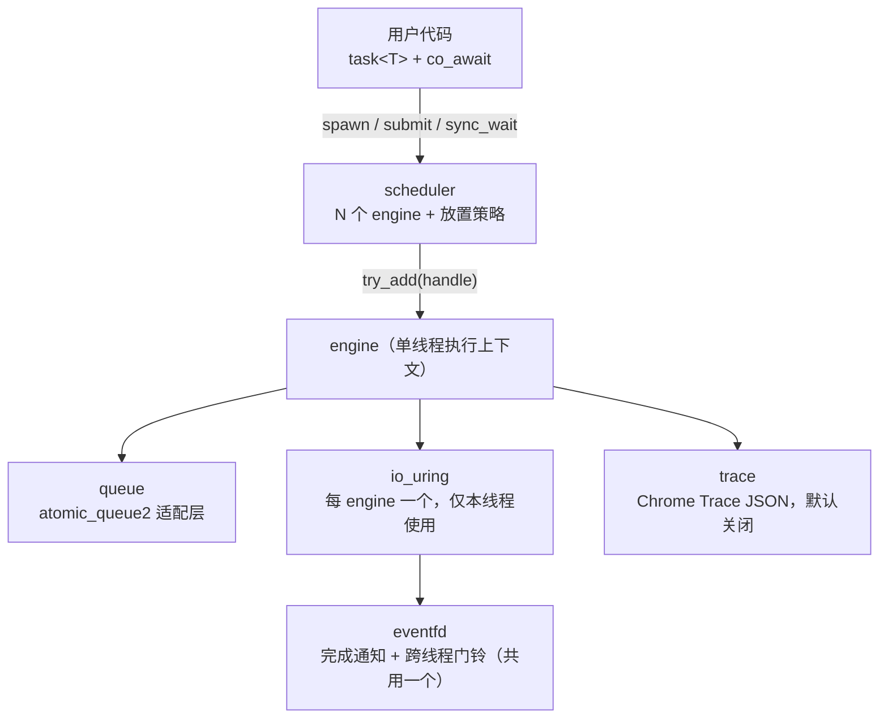

# llco 架构

## 一句话

llco 是一个 C++23 协程编排框架：**task** 负责"怎么写"，**engine** 负责"在哪条线程上按什么顺序跑"，**scheduler** 负责"该放到哪个 engine"。三者之间只通过协程句柄和队列耦合。

## 目标与边界

**目标**

- **易懂**：每一层都能单独读懂，engine 的核心循环不超过一屏，每个模块只有一个职责。
- **易用**：写业务的人只写 `task<T>` 和 `co_await`，不需要知道队列、线程、唤醒的存在。
- **高性能**：默认路径不加锁、不进内核；唤醒只花一次 `eventfd` 写；队列是无锁 MPMC。
- **可替换**：队列、放置策略、IO 后端都能换实现，且换实现不触碰上层。

**非目标（明确不做）**

- 不用在热路径上：协程不是低延迟路径的方案，llco 面向 off-hot-path 的任务编排。
- 不追求 P2300 / `std::execution` 兼容：本机 libc++ 尚未实现 senders/receivers，调度层手写。
- 不做抢占式调度、不做跨进程、不做并行算法的包装。

## 分层与依赖方向



**依赖方向是单向的**，这条规则决定模块怎么切：

- `engine` 认识 queue、io_uring、trace 和 `task`（只为 `spawn`），**不认识** scheduler。
- `scheduler` 认识 engine，**不认识** task 的内部。
- `task` 不认识 engine；唯一需要 engine 的地方是 `co_await resume_on(e)`，它只依赖一个最小概念（见下），不依赖 engine 类型。
- `io_uring` 只在 engine 内部使用，不泄漏到 task 层。

## 关键概念

- **executor 概念**：`resume_on` 唯一依赖的东西；engine、manual engine 都满足它：

```cpp
concept executor = requires(E& e, std::coroutine_handle<> h) {
    { e.try_add(h) } -> std::convertible_to<bool>;
};
```
- **handle 是唯一的通货**：队列里只放 `std::coroutine_handle<>`（8 字节、可平凡拷贝）。awaiter 不放队列——它活在协程帧里，寿命与队列不一致。
- **父协程**：一个协程结束后把控制权交回去的那个协程，也就是 `co_await` 它的那个协程。顶层任务没有父协程，控制权交回 `noop_coroutine`。

## 一次任务的生命周期

1. 用户写 `task<T>`（惰性，未开始）。`main` 通过 `scheduler.submit(std::move(t))` 或 `engine.spawn(std::move(t))` 交出所有权；或者在自己的协程里 `co_await` 一个子任务。
2. 提交：`task::release()` 交出句柄 → 句柄进目标 engine 的队列 → 写门铃 → 返回。
3. engine 线程取出句柄 → `resume()` → 协程跑到第一个真正的挂起点。
4. 协程里 `co_await` 子任务：**inline symmetric transfer**，同一个线程直接跑子协程，不入队（ADR-0001）。
5. 需要换 engine / 换线程时：`co_await resume_on(other_engine)` → 自己的句柄入队（队列满则内联继续，ADR-0004）。
6. 协程结束：final awaiter 把控制权交回**父协程**；如果是 detached 任务，则就地自毁。
7. `sync_wait(t)` 的调用线程（很可能是 `main`）用 `std::binary_semaphore` 睡到任务结束，再把值或异常取走。**注意**：这是调用线程的阻塞点，与 engine 的 blocking point 无关，两者不共用原语。

## 五条关键机制

### 1. 父协程在哪条线程上继续：默认 inline

`co_await` 子任务时不经过队列（ADR-0001）。代价是一条链会吃栈深、且不会主动换线程；收益是默认路径没有任何队列往返。需要公平性或防线长栈时补 `yield_on(engine)`，而不是改默认行为。

### 2. 阻塞点：每 engine 一个 ring + 一个共享 eventfd

每个 engine 在 `start()` 时建一个 io_uring 实例（不重复构造，只由本线程使用），用 `io_uring_register_eventfd` 的 `_ASYNC` 变体把该 engine 的 eventfd 绑进 ring。engine 线程在"没有任务、也没有完成事件"时阻塞在 `read(eventfd)`：内核在 CQE 完成时写这个 fd，任何线程投递任务后也写同一个 fd——**完成通知和门铃共用一个阻塞点**，不需要 epoll（ADR-0003）。醒来后先排空任务队列、再排空 CQ ring，两处都空才回去阻塞。

**门铃优化**是单独一步：`atomic<bool> sleeping` + "先置位、再复查队列"的 double check，写反就是漏唤醒。

### 3. 满载与背压

队列有界。外部路径返回 false（scheduler 负责换 engine 重试）；`spawn` 转移所有权后无路可退，满载即销毁帧并返回 false，所以返回值必须检查；协程内部的 `resume_on` 无处返回失败，约定"`try_push` 失败则由当前线程内联继续"（ADR-0004）。不阻塞、不静默丢弃、不引入无界兜底。

### 4. 所有权与异常

- `task` 拥有帧，析构即 `destroy()`；`release()` 显式交出句柄。
- `spawn` 之后所有权归 engine：帧在 `final_suspend` 处自毁（promise 的 detached 位）；engine 必须比它 spawn 出去的任务活得久，manual engine 销毁前先排空队列。
- 未捕获异常存在 promise 里，由 `co_await` 处 rethrow；detached 任务的异常交给 engine 的 exception handler，默认 `std::terminate`（响亮优于静默）。

### 5. 关停顺序

`request_stop()` → stop_callback 写门铃 → 线程醒来 → 排空队列与 CQ → 退出循环 → `join()` → 释放 ring。析构 = `request_stop()` + `join()`，不 detach 线程、不静默丢任务。

## 文件布局约定

除 `task.hpp`、`attr.hpp`、`config.hpp`、`llco.hpp` 四个单文件外，每个模块拆成 `*.decl.hpp` + `*.impl.hpp`，都放在 `include/llco/` 下；**没有 `src/` 目录**（纯 header-only，CMake 里 `llco` 是 INTERFACE 库）。

```
include/llco/
  task.hpp  attr.hpp  config.hpp          # 单文件例外
  llco.hpp                                # 伞头文件：使用者只 include 它
  executor.decl.hpp                       # 只有一个 concept，不拆 impl
  queue.decl.hpp        queue.impl.hpp
  engine.decl.hpp       engine.impl.hpp
  scheduler.decl.hpp    scheduler.impl.hpp
  sync_wait.decl.hpp    sync_wait.impl.hpp
  latch.decl.hpp        latch.impl.hpp
  event.decl.hpp        event.impl.hpp
  when_all.decl.hpp     when_all.impl.hpp
  when_any.decl.hpp     when_any.impl.hpp
  trace.decl.hpp        trace.impl.hpp
  io/io_uring.decl.hpp  io/io_uring.impl.hpp
```

四条硬规则：

1. **入口只有一个**：`*.decl.hpp` 末尾 `#include "同模块.impl.hpp"`；`*.impl.hpp` 顶部反过来 include `.decl.hpp`（`#pragma once` 兜住循环）。用户永远只 include `.decl.hpp`，不存在"忘了 include impl 导致链接错误"。
2. **非模板函数必须 `inline`**：写在类外的成员函数/自由函数都要 `inline`（类内定义不用）。engine 是类模板所以天然安全；`scheduler`、`trace` 这类非模板的靠纪律。
3. **纯概念文件不拆**：`executor.decl.hpp`、`config.hpp` 没有 impl。
4. **伞头文件只给使用者**：`llco.hpp` 只 include 各模块的 `.decl.hpp` 与单文件头；内部头一律精确 include、不得 include 伞头文件；tests 保持精确 include，用来验证每个头文件自包含。可选或重型模块（trace、io）默认不进伞。

## 模块替换

| 模块 | 机制 | 换法 |
|---|---|---|
| queue | C++20 concept + 别名 | 改 `config.hpp` 里的 `queue_type`（或 CMake 变量 `LLCO_QUEUE`） |
| 放置策略 | runtime 多态（调用频率低） | 构造 scheduler 时传入 |
| IO | 只有一个实现（io_uring），具体类 + 极窄接缝 | 出现第二个后端时再抽接口 |
| trace | 编译期开关 | `LLCO_TRACE=ON`（默认关，零开销） |

热路径（queue）用静态多态保证内联；非热、实现大的（放置策略）用虚接口。CMake 只生成 `config.hpp`，不靠条件排除源码。

## 工程约束（本机实测，2026-10）

- **工具链**：clang 22.1.8 + libc++，`-std=c++23`，CMake 3.28.3 + Ninja，16 核。clang 22 不再需要 `-fcoroutines`（会报 unused 警告）。
- **没有 `std::execution`**：本机 libc++ 的 `<execution>` 只有并行算法，没有 P2300。
- **gtest 本机没装**：走 `FetchContent` 固定 tag（GitHub 可达）；benchmark 自写，不引 google/benchmark。
- **atomic_queue v1.9.4**（MIT，header-only）：
  - **必须 ≥ v1.9.4**：v1.9.3 在 C++20/23 下编译不过（`Rollback` 构造函数）。
  - 用 `AtomicQueue2`（state-array），**不要用** `AtomicQueue`：后者用 `T{}`（空句柄）当空槽标记，推空句柄会 assert/hang。
  - 容量是编译期模板参数，默认向上取整到 2 的幂；要精确用 `MINIMIZE_CONTENTION=false`。
  - `try_push` / `try_pop` 返回 `bool` 且 `[[nodiscard]]`；失败时 `try_push` 不消费元素、`try_pop` 不动出参；阻塞版是纯自旋，无超时/取消。
  - 本机实测：`AtomicQueue2<std::coroutine_handle<>, 8192>` 4 生产者 × 4 消费者 × 25000 句柄，无丢失、无重复。
- **io_uring / eventfd**：liburing 头 2.10 / 运行库 `.so.2` = 2.5（可用；链接时 `-luring` 放源文件之后）；`ulimit -l` = 64MB → 约 7954 个 64-entry ring，够用。
  - 实测：`read(eventfd)` 既能被内核的完成通知唤醒，也能被其它线程的 `write` 唤醒；一次通知可能对应多个完成；醒来时也可能什么都没有。
  - `io_uring_wait_cqe` 返回 `-EINTR` 且不重试——这也是不用它做阻塞点的原因之一（ADR-0003）。
- **可视化**：本机 `perf` 无法录 sched tracepoint（tracefs 只读、`perf_event_paranoid=2`、无 sudo），统一走 **Chrome Trace JSON + Perfetto**；`trace_processor` 可用 SQL 校验 trace，不需要浏览器。

## 还没定、但已经给了默认值的两处

1. **spawn 的首次 resume 在哪里发生**：默认**入队后由 engine 线程执行**（post），而不是在调用线程上 eager start。语义单一、任何线程都能安全 spawn，代价是一次队列往返。
2. **`resume_on` 目标就是当前 engine 时是否短路**：默认**不短路**，照常入队（与 cppcoro 的 `resume_on` 一致），语义可预测。

## 未决与延伸（明确不做在近期）

work stealing、协作式取消（`stop_token` 传播）、优先级队列、手写 MPMC 队列替换 atomic_queue、队列满时的阻塞策略、TCP 之外的网络功能。这些都不影响当前的模块边界。
